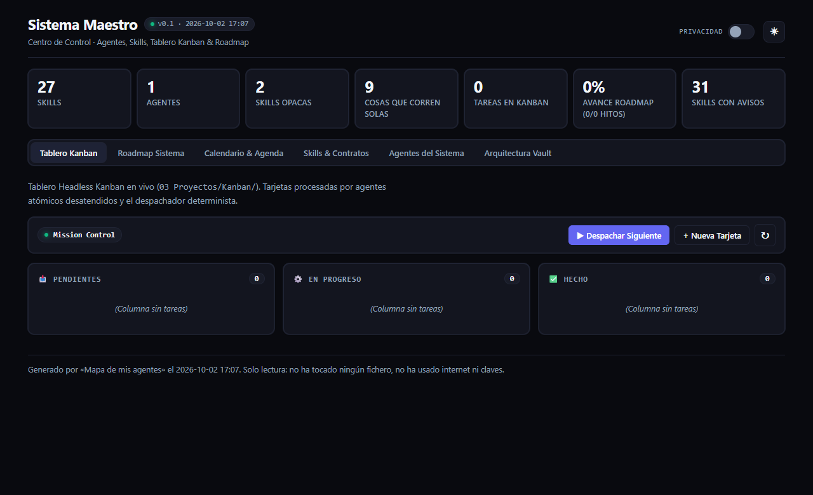
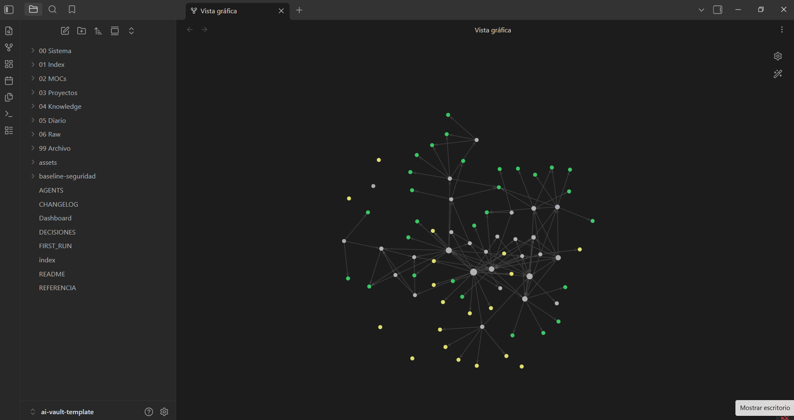

# AI Vault Template

[](CHANGELOG.md)
[](LICENSE)
[](LICENSE-CONTENT)
[](AGENTS.md)

Un sistema operativo agéntico para tus notas en Markdown —un *vault* de Obsidian— con guardas
deterministas en git y CI, estándar multi-agente universal y observabilidad visual offline:

- **ningún secreto entra al historial**: se bloquea en el commit local y otra vez en el PR;
- **ningún comando peligroso se ejecuta**: se inspecciona antes de correr, no después;
- **lo que escribiste vos no lo reescribe un agente**: se marca con centinelas y se verifica en cada commit;
- **las tareas y recibos no pisan tu trabajo**: tablero Headless Kanban con columna `En_Revision/` y validación humana;
- **observabilidad visual offline a 0 tokens**: mapa interactivo en HTML (agentes, skills, contratos, Kanban y rutinas);
- **estándar universal agnóstico**: skills en `.agents/skills/` compatibles con Claude Code, Codex, Antigravity y OpenCode;
- **las mejoras del template te llegan** sin pisar una línea de tu contenido (`update.sh`).

Todo corre con `bash`, `python3` y `git`. Claude Code agrega hooks de sesión, pero **no hace falta**: las
guardas que importan viven en `.githooks/` y en CI, donde no hay harness que valga.

**Qué no es:** no es una app cerrada ni un plugin de Obsidian, es un repositorio de git con hooks ·
no es un framework pesado ni envuelve APIs de pago · no opina sobre cómo tomás notas: impone un
contrato de *metadatos*, seguridad y flujos.

📄 El porqué de cada decisión está en **[DECISIONES.md](DECISIONES.md)**.
🔧 Rutas en duro, supuestos y whitelists para modificar la plantilla, en **[REFERENCIA.md](REFERENCIA.md)**.

**Índice:** [Vistas](#-vistas-del-sistema) · [1. Qué obtenés](#1-qué-obtenés) · [2. Requisitos](#2-requisitos) · [3. Instalación](#3-instalación) · [4. Probalo en 2 min](#4-probalo-en-dos-minutos) · [5. Headless Kanban](#5-tablero-headless-kanban-y-patrón-de-recibos) · [6. Mapa visual](#6-observabilidad-visual-mapa-de-mis-agentes) · [7. Qué corre y cuándo](#7-qué-corre-y-cuándo) · [8. Configuración](#8-configuración) · [9. Actualizarse](#9-actualizarse) · [10. Adaptarlo](#10-adaptarlo-a-tu-repo) · [11. Licencia](#11-límites-y-licencia) · [Glosario](#glosario)

---

## 👁️ Vistas del Sistema

<div align="center">

### Centro de Control, Kanban y Rutinas (`Mapa de mis agentes.html`)
*Observabilidad visual offline de agentes, contratos, rutinas programadas y tareas en vivo — generado en local a 0 tokens en modo oscuro.*



<br/>

### Grafo de Conocimiento Vivo (Obsidian Graph View)
*Red de conexiones emergentes entre SOPs, MOCs, conocimiento y proyectos: «Menos carpetas, más conexiones».*



</div>

---

## 1. Qué obtenés

```text
tu-vault/
├── 00 Sistema/           el contrato: SOPs, 4 plantillas, flujos.yml, centinelas
├── 01 Index/             navegación: visión, objetivos, mapa personal, rutinas externas
├── 02 MOCs/              mapas temáticos (Map of Content)
├── 03 Proyectos/         iniciativas + Kanban/ (Pendientes, En_Progreso, En_Revision, Hecho, Archivado)
├── 04 Knowledge/         conocimiento reutilizable
├── 05 Diario/            diario operativo + Bitácora Agentes/
├── 06 Raw/               fuentes originales sin procesar
├── 99 Archivo/           terminado o retirado
│
├── .agents/skills/       estándar universal: 5 skills agnósticas (AGENTS.md)
├── .claude/              hooks de sesión y git (21 archivos), 3 scripts, 3 comandos, 1 subagente y settings.json
├── .githooks/            pre-commit, pre-push (gates locales deterministas)
├── .github/workflows/    los mismos gates, del lado del servidor (verify.yml, aviso-de-pr.yml)
├── baseline-seguridad/   kit portable: llevás solo la seguridad a otro repo de código
│
├── AGENTS.md             la ley común que lee cualquier agente antes de escribir
├── Dashboard.md          panel de bienvenida y navegación central en Obsidian
├── Mapa de mis agentes   interfaz HTML + JSON interactiva (0 tokens, offline o vía abrir-mapa.cmd)
├── vault.conf            gobernanza: personal o equipo
└── install.sh · update.sh · personalize.sh
```

Las ocho carpetas numeradas forman un pipeline de procesamiento, no un archivador estático:
`06 Raw` → `04 Knowledge` → `02 MOCs` → `01 Index`, de crudo a navegable ([el porqué](<00 Sistema/Cómo funciona este vault.md>)).
Lo que **no** viene es el método personal —cómo estudiar o qué metas ponerte—: entra lo que ejecuta,
y lo que especifica lo que ejecuta.

---

## 2. Requisitos

| Qué | ¿Obligatorio? | Si falta |
|---|---|---|
| `bash` | sí (en Windows: Git Bash) | nada corre |
| `git` ≥ 2.9 | sí | los hooks no se activan (`core.hooksPath` existe desde 2.9) |
| `python3` | en la práctica sí | los hooks que lo usan **dejan de bloquear** (fail-open), en vez de romper la sesión |
| `gh` (GitHub CLI) | no | el aviso de PRs al iniciar sesión sale en silencio y nadie se entera |
| Obsidian | no | podés usar cualquier editor de Markdown; con Obsidian ganás navegación gráfica y [Dashboard.md](Dashboard.md) |
| Cualquier agente (Codex, Antigravity, OpenCode…) | no | leen `AGENTS.md` y ejecutan `.agents/skills/` directamente |
| Claude Code | no | los hooks de evento de `.claude/` quedan inertes; **el gate de git, CI y las skills universales siguen en pie** |

Esa última fila es la decisión de diseño más importante del repositorio: la gobernanza no depende de
una suscripción ni de una herramienta privada ([DECISIONES.md §1–2](DECISIONES.md)).

---

## 3. Instalación

Dos comandos. `install.sh` es **reanudable**: si falta tu identidad, te deja el archivo listo y
para; lo completás, lo volvés a correr y termina.

```bash
# 1. Forkeá en GitHub (o usá "Use this template"), después:
git clone https://github.com/<vos>/<tu-vault>.git
cd <tu-vault>

# 2. Instalar
./install.sh          # cablea hooks, engancha upstream, prepara owner.env y para
#    → completá owner.env (OWNER, OWNER_EMAIL, OWNER_GITHUB)
./install.sh          # retoma: resuelve los placeholders y termina
```

**Forkeá, no clones directo del template.** Si `origin` apunta al template original, `install.sh` no
personaliza nada y te avisa cómo arreglarlo. El motivo: `pre-push` bloquea todo push a un remoto de
la familia `ai-vault-template` / `sistema-maestro-*` cuando el clon ya tiene `owner.env`, porque
publicaría tu nombre y tu correo en el repositorio de la plantilla.

```bash
git remote set-url origin https://github.com/<vos>/<tu-vault>.git
./install.sh
```

**Qué hace el instalador** (es idempotente: correrlo de nuevo no rompe nada):

| Paso | Qué hace | Por qué |
|---|---|---|
| Hooks | `git config core.hooksPath .githooks` | `.git/hooks/` no se versiona: un hook que vive ahí no viaja con el clon |
| Windows | `git config core.longpaths true` | sin esto, un checkout con rutas largas falla en Windows |
| Estado | crea `.vault-meta/` | marcas de sesión, locks y kill-switches; gitignorado |
| Upstream | `git remote add upstream <url>` | el canal de actualizaciones que exige `update.sh` |
| Identidad | crea `owner.env` y corre `personalize.sh` | resuelve `{{OWNER}}` en plantillas, SOPs y prompts, y borra `FIRST_RUN.md` |

Al abrir el vault en Obsidian, encontrarás **[Dashboard.md](Dashboard.md)** en la raíz como panel
de bienvenida y navegación central. Si preferís hacer la configuración inicial conversando con el
agente, corré `/onboarding`.

---

## 4. Probalo en dos minutos

Los cinco comandos que demuestran que las guardas, el tablero y la observabilidad están encendidos:

```bash
# 1. La guarda de secretos bloquea el commit de verdad
printf 'AWS_SECRET_ACCESS_KEY=%s%s\n' AKIA 0000000000000000 > fuga.txt
git add -f fuga.txt && git commit -m prueba     # → debe FALLAR
git reset && rm fuga.txt

# 2. El guard de comandos bloquea ANTES de ejecutar
echo '{"tool_name":"Bash","tool_input":{"command":"cat .env"}}' \
  | python3 .claude/hooks/security-guard.py ; echo "exit=$?"   # → exit=2 (bloqueado)

# 3. El auditor de seguridad completo (5 áreas en verde)
bash .claude/hooks/security-audit.sh

# 4. Creá una tarjeta en el tablero Headless Kanban
python3 .claude/scripts/crear-tarea.py --titulo "Auditar enlaces rotos" --agent mantenedor --skill check-links

# 5. Regenerá el mapa visual de tus agentes (0 tokens)
python3 .claude/scripts/mapa-agentes.py
```

### Qué esperar en tu primera sesión con un agente

- **Al abrir sesión** (en Claude Code), cuatro hooks `SessionStart` inyectan el último handoff de la bitácora, avisan si hay rutinas vencidas, chequean si hay versión nueva en `upstream` y listan PRs abiertos.
- **Al cerrar una sesión que editó archivos del vault**, el hook `Stop` (`agent-diary.sh`) **frena el cierre una vez** y le pide al agente que escriba su entrada de handoff en `05 Diario/Bitácora Agentes/AAAA-MM.md`. No es un cuelgue: en cuanto registra la entrada, cierra normalmente.

---

## 5. Tablero Headless Kanban y Patrón de Recibos

El **Tablero Headless Kanban** (`03 Proyectos/Kanban/`) desacopla tu atención del trabajo en segundo
plano de los agentes mediante cinco carpetas de estado: `Pendientes/`, `En_Progreso/`,
`En_Revision/`, `Hecho/` y `Archivado/`.

En lugar de mantener un chat abierto esperando a que un agente termine, cualquier actor deposita una
tarjeta Markdown en `Pendientes/`.

### El principio: los agentes proponen, las personas deciden

Un agente autónomo **nunca sobreescribe ni publica directamente notas permanentes**. En su lugar,
aplica el **Patrón de Recibos (Human-in-the-Loop)**:

1. **El agente trabaja:** Genera el borrador o reporte en su ruta correspondiente.
2. **Emite un recibo:** Crea una tarjeta con `--recibo` (que entra para revisión humana en `En_Revision/` o `Pendientes/` según el flujo) con el enlace al borrador y los criterios de aceptación.
3. **Validación humana:** Revisás el entregable cuando quieras, aprobás el cambio y movés la tarjeta a `Hecho/`.

```bash
# Crear un recibo de validación humana
python3 .claude/scripts/crear-tarea.py --titulo "Revisar borrador propuesto" --agent general --recibo
```

---

## 6. Observabilidad Visual (`Mapa de mis agentes`)

Tener agentes, hooks y rutinas no sirve si no sabés qué tenés instalado ni si corrió bien.

El script `.claude/scripts/mapa-agentes.py` hace análisis estático determinista del repositorio y
genera **`Mapa de mis agentes.html`** (más su snapshot `Mapa de mis agentes.json`):

- **Cero tokens / 100% local:** No consume APIs de pago ni saca un byte de tu máquina.
- **Grafo y catálogo:** Visualiza quién llama a quién, qué skills existen en `.agents/skills/`,
  qué comandos tenés en `.claude/commands/` y qué flujos están declarados en `00 Sistema/flujos.yml`.
- **Tablero Kanban interactivo:** Muestra las columnas (`Pendientes`, `En_Progreso`, `En_Revision`, `Hecho`) y permite mover tarjetas desde la interfaz.
- **Pestaña «Rutinas & Calendario»:** Semáforo por rutina (`bien` · `falló` · `sin corridas` · `pausada`) combinando tareas `SistemaMaestro-*` del Programador de Tareas de Windows, rutinas cloud (`.vault-meta/rutinas-cloud.json`) y las rutinas externas que anotes en `01 Index/Registro de Rutinas Externas.md`.
- **Cómo abrirlo:** En Windows, ejecutá **`.claude/scripts/abrir-mapa.cmd`** (levanta el servidor local si no está corriendo y abre el navegador; podés crearle un acceso directo en el escritorio), o hacé doble clic sobre `Mapa de mis agentes.html` para abrirlo en modo lectura estática.

---

## 7. Qué corre y cuándo

**Harness:** `CC` = solo dentro de Claude Code. `todos` = cualquier agente (Codex, Antigravity,
Claude Code, OpenCode) y humanos.

| Pieza | Se dispara con | Harness | Kill-switch (`.vault-meta/…`) |
|---|---|---|---|
| `session-context.sh` | inicio de sesión | CC | `session-context.disabled` |
| `check-routines.sh` | inicio de sesión | CC | `routines-monitor.disabled` |
| `update-notice.sh` | inicio de sesión | CC | `update-notice.disabled` |
| `pr-notice.sh` | inicio de sesión | CC | `pr-notice.disabled` |
| `pre-compact.sh` | antes de compactar contexto | CC | `precompact.disabled` |
| `sentinels-guard.sh` + `.py` | antes de `Write`/`Edit` | CC | `sentinels.disabled` |
| `security-guard.sh` + `.py` | antes de `Bash`/`Read`/`Write`/`Edit` | CC | `security-guard.disabled` |
| `auto-commit.sh` | después de `Write`/`Edit` | CC | `autocommit.disabled` |
| `agent-diary.sh` | cierre de sesión (`Stop`) | CC | `diary.disabled` |
| `check-diary-size.sh` | lo llama `agent-diary.sh` | CC | `diary-cap.disabled` |
| `agent-diary` (`.agents/skills/`) | cierre de sesión (manual/skill) | todos | `diary.disabled` |
| `check-links` (`.agents/skills/`) | bajo demanda / mantenimiento | todos | — |
| `verifier` (`.agents/skills/`) | antes de `git commit` (self-review) | todos | — |
| `security-audit` (`.agents/skills/`) | bajo demanda / auditoría | todos | — |
| `crear-tarea` (`.claude/scripts/crear-tarea.py`) | creación de tareas y recibos | todos | — |
| `harden-links.py` | bajo demanda / enlaces | todos | `harden.disabled` |
| gate de rama | `git commit` | todos | `branch-gate.disabled` |
| `secret-scan.sh` | `git commit` + CI | todos | `secret-scan.disabled` |
| `sentinels-verify.py` | `git commit` + CI | todos | `sentinels.disabled` |
| `generate-index.py` | `git commit` | todos | `index-gen.disabled` |
| `verify-commit.sh` | `git commit` + CI | todos | `verifier.disabled` |
| `.githooks/pre-push` | `git push` | todos | `prepush.disabled` |
| `verify.yml` · `aviso-de-pr.yml` | Pull Request | todos | desactivar el workflow |
| `revision-adversarial` (`.agents/skills/`) | antes de `git commit`, si toca hooks o CI | todos | — |
| `tests.yml` | Pull Request + push a la rama principal | todos | desactivar el workflow |

Los kill-switch los crea una persona: `security-guard` bloquea que un agente cree un
`.vault-meta/*.disabled`, cambie `core.hooksPath` o commitee con `--no-verify`.

### Tests de las guardas

Casi todos los hooks son *fail-open*: ante un error, permiten. Una guarda rota no falla,
deja pasar. Por eso las guardas tienen su propia suite en `tests/`, que corre contra un
repo descartable y nunca toca tu vault:

```bash
python -m pip install -r tests/requirements.txt   # pytest, hypothesis, ruff — solo para testear
python -m pytest tests -q
```

| Qué prueba | Cómo |
|---|---|
| Contrato de cada guarda | casos «bloquea» y «permite», ejecutando el script real |
| Evasiones | corpus adversarial: cada evasión cerrada queda como test de regresión, y los límites conocidos de la guarda por regex quedan listados como tales |
| Invariantes | propiedades con Hypothesis: regenerar índices o endurecer enlaces dos veces no cambia nada; editar fuera de un bloque `@user` nunca bloquea y editar dentro siempre |
| Coherencia | el kit de `baseline-seguridad/` no se desfasa del original; `settings.json` invoca scripts que existen |

Los hooks siguen sin dependencias (bash y la biblioteca estándar de Python); lo de
`tests/requirements.txt` solo hace falta para correr los tests. Si un fail-open se dispara,
el motivo queda en `.vault-meta/guard-errors.log`.

---

## 8. Configuración

| Archivo | Qué es | ¿Se versiona? |
|---|---|---|
| `owner.env` | Identidad: `OWNER`, `OWNER_EMAIL`, `OWNER_GITHUB` | **no** (gitignoreado) |
| `vault.conf` | Gobernanza: `VAULT_MODE`, `MAIN_BRANCH`, `TEAM_MEMBERS` | **sí** |
| `.vault-meta/*.disabled` | Kill-switches locales, uno por guarda | **no** |

**Si lo van a usar varias personas**, editá `vault.conf` y commitealo:

```ini
VAULT_MODE=equipo        # personal (default) | equipo
MAIN_BRANCH=main
TEAM_MEMBERS="Ana,Beto"
```

⚠️ Con `VAULT_MODE=equipo`, **todo commit directo sobre `main` queda bloqueado** (y `auto-commit.sh` se apaga solo). La salida es abrir rama (`git switch -c <prefijo>/<tema>`) o usar `--no-verify` para una excepción puntual.

---

## 9. Actualizarse

```bash
./update.sh --check      # ¿hay versión nueva en upstream? No toca nada
./update.sh --dry-run    # muestra qué archivos cambiarían
./update.sh              # interactivo: lista cambios y pide confirmación
```

El actualizador copia por whitelist (`vault-manifest.json`) dividiendo el repo en tres clases:

| Clase | Qué es | Qué hace `update.sh` |
|---|---|---|
| `infrastructure` | Hooks, `.agents/**`, `.claude/**`, `.githooks/`, workflows, `00 Sistema/`, `baseline-seguridad/`, `Mapa de mis agentes.html`, docs del template | se sobrescribe siempre |
| `scaffold` | `owner.env`, `vault.conf`, `FIRST_RUN.md`, `Dashboard.md`, stubs de `01 Index/` (incl. `Registro de Rutinas Externas.md`), carpetas de `03 Proyectos/Kanban/` | se instala una vez y **nunca** se pisa |
| contenido | todo lo demás (tus notas, proyectos, diario, MOCs, `Raw`) | no se toca jamás |

---

## 10. Adaptarlo a tu repo

**(a) Querés un vault entero.** Seguí la [sección 3](#3-instalación). Es el camino recomendado.

**(b) Querés solo la seguridad, en un repo de código.** Usá
[`baseline-seguridad/`](<baseline-seguridad/README.md>): archivos copiables y autocontenidos
con las capas 1 a 3 (`settings.json`, `security-guard`, `secret-scan` y `pre-commit`) para cualquier proyecto.

**(c) Querés los hooks sobre tu propia estructura de carpetas.** Se puede; las nueve rutas en duro y el orden para reescribirlas están documentados en [REFERENCIA.md §2](REFERENCIA.md).

---

## 11. Límites y licencia

Doble licencia, **por ruta** (sin ambigüedad por extensión):

| Rutas | Licencia |
|---|---|
| `.agents/**`, `.claude/**`, `.githooks/**`, `.github/**`, `baseline-seguridad/**`, `*.sh`, `*.py`, `*.yml`, `Mapa de mis agentes.html`, `Mapa de mis agentes.json`, `vault-manifest.json`, `vault.conf`, `owner.env.example`, `VERSION`, `.gitignore`, `.gitattributes` | [MIT](LICENSE) |
| Los `.md` **fuera** de esas rutas: `00 Sistema/**`, `01 Index/**`, `03 Proyectos/**`, `05 Diario/**`, `AGENTS.md`, `Dashboard.md`, `README.md`, `DECISIONES.md`, `REFERENCIA.md`, `CHANGELOG.md`, y la arquitectura de carpetas | [CC BY-NC-SA 4.0](LICENSE-CONTENT) |

Historial de versiones en [CHANGELOG.md](CHANGELOG.md).

---

## Glosario

| Término | Qué significa acá |
|---|---|
| **vault** | La carpeta de notas en Markdown, con su estructura y su contrato. No es una base de datos ni una app |
| **harness** | La herramienta desde la que corre el agente (Claude Code, Codex, Antigravity, OpenCode). Un control que solo vive en un harness protege solo mientras uses ese harness |
| **centinela** | Marca `<!-- @user -->` / `<!-- @generated -->` que declara qué bloque de un documento es tuyo y cuál puede regenerar el sistema |
| **gate** · **guarda** | Chequeo determinista que puede **bloquear** una acción (un commit, un push, un comando) si viola una política |
| **Headless Kanban** | Tablero asíncrono de tarjetas Markdown en `03 Proyectos/Kanban/` para delegar tareas a agentes sin mantener sesiones de chat abiertas |
| **recibo** | Tarjeta de tarea emitida por un agente tras generar un borrador para que la persona revise en `En_Revision/` antes de dar por bueno el cambio |
| **Mapa de agentes** | Interfaz HTML interactiva offline generada con 0 tokens de LLM que refleja el grafo de dependencias, el Kanban y el estado de las rutinas |
| **fail-open** | Si a la guarda le falta una dependencia (`python3`), deja pasar en vez de romper la sesión de trabajo |
| **warn-only** | El chequeo avisa pero no bloquea (modo por defecto de `verify-commit.sh`, salvo `VERIFIER_STRICT=1`) |
| **infrastructure** · **scaffold** | Las dos clases de la whitelist del updater: lo primero se sobrescribe con updates, lo segundo se instala una vez y nunca se pisa |
| **upstream** | El remote de git que apunta al template original para recibir mejoras vía `update.sh` |

© 2026 Leandro Esteban Aguilar Montilla.
